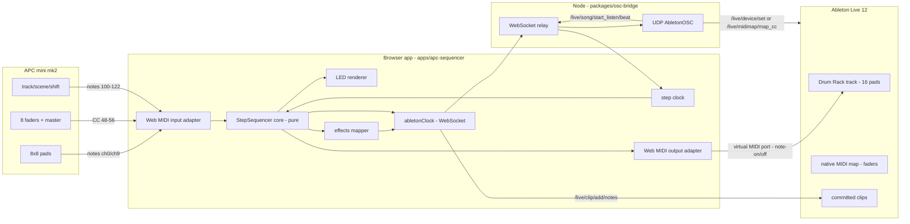

# APC mini mk2 as a Step Sequencer for a 16-pad Ableton Drum Rack

Status: **Phases 1–3 + Phase 4a (bank/fader/live control) implemented**. Phases 1–2
(controller runtime layer + pure sequencer core) are unit-tested and green —
`@hardware/controller-bridge` 31 tests, `@hardware/step-sequencer` 74 tests.
Phase 3 (`apps/apc-sequencer`, the real browser app: Web MIDI in/out + AbletonOSC +
step clock + LED render, Drum-Rack layout) is built, typechecks, builds, and is
verified running in the browser. Live/AbletonOSC hookup needs the one-time setup in
§9; pad-mode must be **Session** (grid LEDs only light in Session mode — SHIFT+Scene
8 cycles modes; the app forces Session via sysex). Phase 4a added the **bank /
fader-mode / live-mode** control scheme (§4a): two 8-pad drum banks (Bank A = bottom
two rows, pads 8-15; Bank B = top two rows, pads 0-7), per-pad mute + level,
fader modes Volume (in-app) / Device (macros P0-P7, verified) / Send (track sends) /
Pan (track panning), and a Live mode (taps play, track 1 = rec-arm). Phase 4b
(osc-bridge `songTime` relay, clip commit, per-pad pan/send via an M4L macro device)
not started. Goal: drive an Ableton Drum Rack (16 samples) from the Akai APC mini
mk2 as a hardware step sequencer — up to **32 steps**, with the 8 faders + master
fader controlling per-drum level or device parameters — with LED feedback on the
8×8 grid.

This doc records the verified facts the design rests on, the architecture decision
(and the alternatives rejected and why), the concrete pad/fader layout, the exact
OSC/MIDI endpoints to use, and a phased implementation plan mapped onto this repo's
existing packages and conventions.

## 0. Implemented so far (Phases 1–2)

**Visual references** (open these to see the layout):
- `docs/apc-mini-mk2-sequencer-layout.svg` — static, color-coded diagram of the
  whole controller: 8×8 pad grid (bank A / page 1 example), scene & track button
  roles, faders + master + shift, LED color legend, navigation formulas, MIDI notes.
  Preview it directly in VS Code or any browser.
- `docs/apc-mini-mk2-control-reference.html` — interactive reference: click pads to
  place hits, flip sample banks (A/B) and step pages (1–4), press play to watch the
  playhead sweep, hover pads for exact `voice / step / note` mapping, and reference
  cards for scene/track/fader roles. Doubles as the Phase-3 browser UI seed.

**Phase 1 — `@hardware/controller-bridge` runtime layer**
- `src/elements/apc-mini-mk2.ts`: pads now carry `ledChannel: 6` (FULL_BRIGHTNESS).
- `src/colors/apc-mini-mk2.ts` (new): RGB palette (BLACK/GREY/RED/AMBER/YELLOW/GREEN/
  OCEAN/BLUE) + brightness channels (half/full/pulse/blink), ported from `colors.py`.
- `src/midi.ts` (new): `parseMidiMessage`, `resolveIncoming` (matrix-cell resolution
  by channel+msgType+note — closes the whole-matrix `getMidi` gap for the sequencer),
  `buildPadModeSysex`, `buildLedOn/Off`, `buildCellLed`, `cellNote`, `cellLedChannel`.
- `test/midi.test.ts` (new, 19 tests incl. the note-vs-CC-48 collision regression).

**Phase 2 — `@hardware/step-sequencer`** (new shared package, registered in
`platform.config.json`, depends on `@hardware/controller-bridge`; 53 tests)
- `src/pattern.ts`: 32-step × 16-voice `StepPattern` + editing (toggle/set/velocity/
  accent/clear/copy/randomize), a `last` cache so toggling a step back on restores
  its velocity/accent, and compact `serialize`/`deserialize`.
- `src/clock.ts`: pure step clock — `advanceBySeconds` (free-run) and `followLive`
  (phase-lock to Ableton fractional song time), resolution-aware (16th/8th).
- `src/grid.ts`: `padToEdit`/`visibleCells` (voice = bank*8+row, step = page*8+col)
  + track/scene button role tables.
- `src/led.ts`: `renderGrid` → per-pad `{note, ledChannel, color, channel?}` writes
  (hits yellow, focused row ocean, playhead column green with a pulse-channel sweep).
- `src/effects.ts`: 8 fader + master effect-slot model, learn mode, CC↔param value
  conversion, `slotsFromParameters`.
- `src/transport.ts`: `stepTriggers` (realtime) + `patternToClipNotes` (commit-to-clip)
  + swing offset helper, built on the rack's discovered receiving notes.

All green under the repo-pinned Node 24: controller-bridge 31/31, step-sequencer
53/53, both packages typecheck and build (tsup cjs+esm+dts).

> **Layout revision (Drum-Rack style).** The hardware mapping was revised to mirror
> the Ableton Drum Rack: bottom-left 4×4 = the 16 drum pads (notes 36–51, kick
> bottom-left, tap = preview + select), top 4×8 = the selected pad's 32-step
> sequencer with **per-pad sequence length set via shift+step**, bottom-right 4×4 =
> FX pads. Both visual references above show this layout. `@hardware/step-sequencer`
>'s `grid.ts` still encodes the *earlier* rows=voices/cols=steps mapping; Phase 3's
> browser app will add the Drum-Rack geometry (a `drumRackGrid` view over the same
> pattern/clock/led core). The pure core (pattern/clock/led/transport/effects) is
> layout-agnostic and unchanged.

**Phase 3 — `apps/apc-sequencer` (real browser app, built + verified in browser)**
- `packages/step-sequencer/src/drumRackGrid.ts` (new, pure, 12 tests): the Drum-Rack
  geometry — 16 pads × 32 steps, per-pad `length`, `resolvePadPress`,
  `renderDrumRackLeds`, `drumRackTriggers`. Grid/scene/track role names updated to
  the Drum-Rack layout (solo_pad / mute_pad / clear_pad).
- `apps/apc-sequencer/` (new Vite React app):
  - `src/lib/store.ts` — zustand state (drum, selectedPad, fx, shift, bpm, transport, ports).
  - `src/lib/midi.ts` — Web MIDI in/out (APC auto-detect, IAC rack out, LED/sysex sends).
  - `src/lib/osc.ts` — WebSocket AbletonOSC client (beat/playState/telemetry + commands).
  - `src/lib/clock.ts` — drift-corrected free-run step clock (+ beat re-sync).
  - `src/lib/hub.ts` — wiring: MIDI input / UI clicks → state → rack note-out +
    LED render + OSC (faders → device params). Simulator-safe without hardware.
  - `src/App.tsx` + CSS — Drum-Rack grid mirror, controls, status, reference cards.
  - **MIDI port picker** — a "MIDI ports" card lists every Web MIDI input/output
    and lets you pick APC input / APC LED out / IAC rack out manually (needed when
    the APC sits behind an iConnectivity interface with a non-"APC" port name).
  - `README.md` — run + Live one-time setup (AbletonOSC, osc-bridge, IAC bus, routing).
- Verified in the browser (dev server on :5184): drum-pad select + preview, step
  toggle, shift+step → length, FX pads, playhead sweep, graceful no-Live fallback.

---

## 1. Goal and non-goals

**Goal**

- APC mini mk2 → live, realtime step sequencing of a single Drum Rack track with
  16 pads/samples.
- Up to 32 steps (16th-note resolution, banked), velocity per step, play/stop.
- 8 faders control effect parameters (Drum Rack macros / device parameters).
- LED feedback: step position, active steps, selected sample, page/bank state.
- Patterns are also committable as real MIDI clips on the Drum Rack track.

**Non-goals (v1)**

- Multi-track sequencing / multiple clips at once.
- A full "Push-style" note/instrument mode (pads are for drums only in v1).
- Polyphonic melodic sequencing (the 8 faders are the only continuous controls).
- Replacing the drum-library / blueprint pipeline — the sequencer is a *playing*
  tool; the existing `@drum/library` + `trackdraft-bridge` remains the *writing* tool.

---

## 2. Verified facts this design relies on

### 2.1 The controller (`packages/controller-bridge`, reference `APC_mini_mk2/elements.py`)

| Element | MIDI | Channel | Notes |
|---|---|---|---|
| 8×8 clip-launch pads | notes 0–63 | 0 | RGB; LED channel 6 (FULL_BRIGHTNESS) |
| 8×8 drum pads | notes 64–127 | 9 | RGB (drum pad mode) |
| 8 track buttons | notes 100–107 | 0 | below the grid |
| 8 scene-launch buttons | notes 112–119 | 0 | right of the grid |
| 8 faders | CC 48–55 | 0 | absolute |
| master fader | CC 56 | 0 | encoder, absolute |
| shift button | note 122 | 0 | modifier |
| pad-mode control | sysex `[F0 47 7F 4F 62 00 01 <mode> F7]` | — | switches grid session/drum/note |

Rows are flipped (physical bottom row = index 0). RGB palette (from `colors.py`):
BLACK 0, GREY 1, RED 5, AMBER 9, YELLOW 13, GREEN 21, OCEAN 41, BLUE 45; brightness
channels HALF=1, FULL=6, PULSE=10, BLINK=14. Pads light via **note-on on the LED
channel with velocity = palette value** — no sysex needed for per-pad LEDs.

> Gap found: the ported `APC_MINI_MK2` element defs mark pads `isRgb: true` but carry
> no `ledChannel` (the reference script sets `led_channel=FULL_BRIGHTNESS_CHANNEL=6`
> for clip-launch pads). The sequencer's LED layer needs that metadata — see §7, P1.

### 2.2 The hard platform constraint (`docs/architecture.md`)

The **Extensions SDK cannot do realtime audio/control** (no playhead, no realtime
MIDI, no per-note output). The repo's own `osc-bridge` exists precisely to cover the
realtime gap via AbletonOSC. **Therefore the step sequencer must not be built as an
Extensions SDK feature.** It is built as a browser app + Web MIDI + OSC, matching the
pattern already proven in `apps/trackdraft` (§2.4).

### 2.3 AbletonOSC endpoints (verified against `idoforms/AbletonOSC` source)

The browser talks to Live through the existing `osc-bridge` WebSocket, which already
forwards arbitrary `/live/...` commands. Confirmed endpoints relevant here:

- **Effects (device parameters)**
  - `/live/device/get/num_parameters  track device`
  - `/live/device/get/parameters/name|value|min|max|is_quantized  track device`
  - `/live/device/set/parameter/value  track device param value`
  - `/live/device/start_listen/parameter/value  track device param`
  - `/live/midimap/map_cc  track device param channel cc` — **maps a CC to a
    parameter using Live's native MIDI map.** Ideal for the 8 faders: no browser
    round-trip, Live handles them at hardware latency.
- **Transport / tempo**
  - `/live/song/start_listen/beat`, `/live/song/start_listen/is_playing` (already used by `osc-bridge`)
  - `/live/song/set/tempo  bpm`
- **Committed clips**
  - `/live/clip/add/notes  track clip [pitch start_time duration velocity mute]...`
  - `/live/clip/get/notes`, `/live/clip/remove/notes`
  - `/live/clip/set/loop_start|loop_end|looping|name ...`

### 2.4 Already-built blocks in this repo to reuse

| Block | Location | What it gives us |
|---|---|---|
| APC element/mapping/mode defs | `packages/controller-bridge/src` | note/CC numbers, matrix layout, sysex header |
| Web MIDI input consumer | `apps/trackdraft/src/lib/playback/userMidi.ts` | pattern for `navigator.requestMIDIAccess` input dispatch |
| WebSocket OSC client | `apps/trackdraft/src/lib/playback/abletonClock.ts` | `sendCommand("/live/...", args)` over `osc-bridge` |
| Precise scheduler | `apps/trackdraft/src/lib/playback/{clockWorker,songTransport}.ts` | worker-based lookahead scheduling ("A Tale of Two Clocks") |
| Drum Rack introspection | `extensions/trackdraft-bridge/src/drumRackProbe.ts` | reads real per-pad `receivingNote` from a loaded rack |
| Drum note folding | `packages/drum-library/src/ableton.ts` | `ABLETON_SAFE_NOTES`, `foldForAbleton` for note→rack mapping |

`@hardware/controller-bridge` is already registered in `platform.config.json`, so a new
shared package can depend on it by name.

---

## 3. Architecture decision

**Primary: browser app + Web MIDI + `osc-bridge` (AbletonOSC) + a virtual MIDI port
into Live.** The sequencer state machine and pattern memory live in the browser; the
APC is a dumb controller; Live stays the audio engine.



### 3.1 Why this split

- **Why the browser, not a Python Remote Script:** the repo has no Remote-Script
  infrastructure (it's a TS/Node monorepo; the only Python is vendored reference
  scripts). A custom Remote Script would be the most "native" option but is a second
  toolchain and gives up everything the repo already has (Web MIDI handling, OSC
  relay, the drum library, the Extensions clip-writing pipeline). The browser path
  reuses verified code (§2.4) and keeps the sequencer logic in pure, testable TS.
- **Why Web MIDI, not a Node MIDI lib:** `userMidi.ts` already proves the browser
  route; it avoids a native dependency (`@julusian/midi`) and a separate daemon. The
  browser also naturally hosts the UI/state for pattern editing, and Web MIDI gives
  both input (pads) and output (to a virtual port) in one place.
- **Why a virtual MIDI port for the audio path:** the only way to trigger the real
  Drum Rack at sequencer latency is note-on into the track. Live can't receive
  note-on from a browser directly, so the browser writes to a loopback MIDI port
  (macOS **IAC Driver**, one-time setup in Audio MIDI Setup) and the Drum Rack track's
  MIDI input is set to that port. Web MIDI `output.send()` to an IAC Bus is
  supported in Chrome.
- **Why OSC for effects, not more MIDI:** faders should reach effect parameters at
  hardware latency. Two options, both verified against AbletonOSC:
  1. **Native MIDI map** — `/live/midimap/map_cc` binds fader CC 48–55 to device
     parameters using Live's own MIDI map. Lowest latency, no browser in the path,
     but faders are *also* received directly by Live over USB (see §6.2), so the
     browser must **not** forward them (no double-handling).
  2. **OSC param set** — browser forwards fader CCs to
     `/live/device/set/parameter/value`. Slightly higher latency, fully scriptable.
  Use (1) for the default effect slots, (2) as the fallback / for velocity and
  page-sensitive targets.

### 3.2 Alternatives rejected

- **Extensions SDK-only:** impossible — no realtime path (documented in `architecture.md`).
- **M4L device (`jweb`) as the sequencer brain:** the repo's M4L scaffold is a
  UI-only `jweb` host, not a MIDI-processing patcher; building a 32-step sequencer in
  Max patcher is a large, hard-to-test lift and none of the existing TS infrastructure
  (drum library, controller-bridge, tests) would be reachable from it. Rejected.
- **Node daemon + WebSocket to the app:** Web MIDI in the browser already removes the
  need for a separate MIDI process; a daemon adds a deployment step for no gain. Rejected.
- **Ableton's built-in `APC mini mk2` script for the grid:** it treats pads as session
  clip-launch — wrong mode for a step sequencer. We switch the grid to a note/drum pad
  mode via the pad-mode sysex and interpret pad notes ourselves.

---

## 4. Hardware layout (Drum-Rack style)

The 8×8 grid is split to mirror what you're actually controlling — the Ableton Drum
Rack's 4×4 — instead of a generic rows=voices grid:

```
              STEP SEQUENCER (selected pad's 32 steps)
        col 1  2  3  4  5  6  7  8
row 1  ┌──────────────────────────┐
row 2  │  TOP 4×8 — row-major     │   step = (row-1)×8 + col (1-32)
row 3  │  steps 1-8 / 9-16 /      │   of the SELECTED pad
row 4  │  17-24 / 25-32           │   SHIFT + step = set that pad's length
row 5  ├──────────────┬───────────┤
row 6  │  DRUM PADS   │  FX PADS  │   bottom-left 4×4 = the Drum Rack pads
row 7  │  (rack 4×4)  │ (4×4)     │   kick bottom-left = note 36, up to 51
row 8  │  notes 36-51 │  on=blue  │   tap = live preview + select
       └──────────────┴───────────┘
```

### 4.1 The three grid regions

- **Bottom-left 4×4 (rows 5–8, cols 1–4) = the 16 drum pads**, arranged exactly like
  the Drum Rack / the APC's own drum mode: kick at bottom-left (rack note 36),
  ascending to 51. Mapping: `rackNote = 36 + (8 - row)*4 + (col - 1)`.
  **Tap = audition only** (sends that rack note to Live without switching the step
  editor) — so you can preview other drums without losing your step view. **SHIFT +
  tap = select** that pad for editing. LEDs: selected = OCEAN, has-a-sequence =
  AMBER, firing on the current playhead step = GREEN.
- **Top 4×8 (rows 1–4, cols 1–8) = the selected pad's step sequencer**, 32 steps
  row-major (`step = (row-1)*8 + col`, 1-based). Hits = YELLOW, playhead column =
  GREEN (pulse when empty), steps **beyond the pad's sequence length** are dimmed.
  A loop-end marker (AMBER ring) shows the last active step.
- **Bottom-right 4×4 (rows 5–8, cols 5–8) = FX pads** (toggle/momentary), ON = BLUE.
  Free to repurpose later.

### 4.2 Per-pad sequence length

Each of the 16 pads remembers its own pattern **and its own length (1–32)**. Hold
**SHIFT + a step** on the top grid to set that pad's length to the step number you
pressed (1-based — shift + step 16 = a 16-step loop). The loop wraps within the pad's
length; the playhead only fires hits inside it. **Samples are now selected one at a
time** — the top grid edits the selected pad's sequence (16 pads × up to 32 steps
each), so this replaces the earlier "all 16 voices at once, banked" model.

### 4.3 Scene buttons (notes 112–119) — transport & utility

| Button | Action |
|---|---|
| 0 | Play/Stop (follows Live transport if connected) |
| 1 | Solo the selected pad |
| 2 | Mute the selected pad |
| 3 | Step resolution: 1/16 ↔ 1/8 |
| 4 | Pattern slot A / B toggle |
| 5 | Clear the selected pad's sequence |
| 6 | Follow-Live-transport toggle (free-run vs synced) |
| 7 | Commit pattern → MIDI clip on the Drum Rack track |

### 4.4 Track buttons (notes 100–107) — FX controls

The track buttons become **FX controls** with **per-slot selectable momentary or
toggle** behavior (e.g. FX1–4 toggle, FX5–8 momentary). Master fader = global FX
amount. Faders drive **Ableton device parameters** via OSC
(`/live/device/set/parameter/value`, or native `/live/midimap/map_cc`); the browser
enumerates parameters with `/live/device/get/parameters/name` and re-binds slots in
learn mode.

### 4.5 Faders (CC 48–55) + master (CC 56) — device control

- **Fader 1–8** → 8 device parameters (Drum Rack macros / effect params), default via
  `/live/midimap/map_cc` (native, hardware latency) or `/live/device/set/parameter/value`.
- **Master fader** → global FX amount.
- **Shift + fader** = fine control (scaled steps via OSC instead of raw CC).

### 4.6 Shift (note 122) — modifier layer

Momentary (like Ableton's own script): **shift + step = set sequence length**,
shift+fader = fine FX control, shift+scene/button = the tables above.

### 4a. Phase 4a — bank / fader-mode / live control (implemented)

Rebalances the grid around two 8-pad **drum banks** and mode-aware faders/buttons,
scoped to the one target Drum Rack track.

- **Banks** — the 16 drum pads split into **Bank A** (bottom two rows: pads 8-15)
  and **Bank B** (top two rows: pads 0-7). All 16 stay visible; the active bank is
  which 8 the sliders/buttons drive. Bank slots run bottom-left first
  (`bankSlotPad`): Bank A slot 1 = pad 12 (kick) … slot 8 = pad 11; Bank B slot 1 =
  pad 4 … slot 8 = pad 3.
- **FX region mode row** (bottom-right, first row = FX slots 0-3):
  - slot 0 = **Bank A** · slot 1 = **Bank B** (green LED when active)
  - slot 2 = **Device** fader mode (blue when active)
  - slot 3 = **Live** mode (red when active)
  - slots 4-15 stay FX toggles.
- **Track buttons** (100-107):
  - unshifted = per-drum **mute** for the active bank (pad LED turns red);
  - **SHIFT + 1-4** = fader mode select **Volume / Pan / Send / Device**;
  - **Live mode**: track 1 = **rec-arm** the rack track (`/live/track/set/arm`),
    tracks 2-8 = mute.
- **Faders** (CC 48-55), per the selected fader mode:
  - **Volume** (default) = per-drum **level** in-app (scales trigger velocity —
    no Live dependency);
  - **Device** = `/live/device/set/parameter/value` on the **selected (blue-hand)
    track/device** — the osc-bridge subscribes to `/live/view/start_listen/
    selected_track` + `selected_device`, so whatever device you click in Live is
    what the 8 faders (P0-P7) drive; a "Follow blue hand" toggle falls back to
    the app's target track / device 0 when off (verified);
  - **Send** = `/live/track/set/send [track, send_id 0-7, value]` (track sends);
  - **Pan** = `/live/track/set/panning [track, value]` — track-level, slider 1 only
    (per-pad pan needs the M4L/per-chain route, §Phase 4b).
  - **Master fader** (CC 56) → device 0 parameter 8.
- **Per-pad level + mute** live in the pattern model (`DrumPad.level`, `.muted`);
  `drumRackTriggers` skips muted pads and scales velocity by level; preview taps
  respect both.
- **LEDs** — muted pad red, mode-row active states green/blue/red, selected pad
  ocean (selected wins over muted).

All pure logic + helpers (`bankOfPad`, `bankSlotPad`, `padBankSlot`, `padLevel`,
`padMuted`, mode-row actions) live in `drumRackGrid.ts` with unit tests; the browser
mirrors it 1:1 in `apps/apc-sequencer` (store `bank`/`faderMode`/`liveMode`, hub
dispatch, on-screen per-bank mute+level panel for no-hardware testing).

### 4b. Phase 4b — not started

osc-bridge `songTime` relay (tighter follow-Live phase-lock), scene-7 clip commit,
and per-pad Pan/Send via an **M4L device exposing the 8 pads' volume/pan/send as
macros** (so P0-P7 map predictably — raw Drum Rack parameter order is internal and
unhelpful, e.g. param 0 = device on/off).

---

## 5. How the 16 samples map to real Drum Rack pads

Two sources, in priority order:

1. **Auto-discovery (preferred):** run the existing `trackdraft-bridge` *Probe Drum
   Rack* command on the target track (`extensions/trackdraft-bridge/src/drumRackProbe.ts`).
   It returns each pad chain's `receivingNote` — the exact 16 (or N) notes the rack
   triggers on. The sequencer's 16 selector rows map 1:1 to those notes.
2. **Fallback:** the drum library's consistent set
   (`packages/drum-library/src/ableton.ts` `ABLETON_SAFE_NOTES`), i.e. notes 36–51
   across the kits — only reliable on racks that match (see that file's documented
   808/909 conflicts).

The probe result can also be captured via OSC (`/live/device/get/parameters/name` +
the rack's device chain) if we don't want a manual extension step, but the extension
path is already built and richer (it reports sample paths and velocity params too).

**Note choice on the grid:** rows are *sample selectors* (which sample you're editing /
muting / soloing), not direct trigger pads — triggering while playing comes from the
sequencer's own note-on output on the current playhead step, not from your finger. A
"finger drum" tap layer (tap a row pad to play that sample immediately, velocity
sensitive) is a cheap add-on on top.

---

## 6. Timing, clocks, and avoiding double-handling

### 6.1 Clock

- **Free-run (default):** browser runs its own step clock using the proven
  `clockWorker` + lookahead pattern (like `songTransport.ts`). BPM is pushed to Live
  via `/live/song/set/tempo` and mirrored back; patterns stay in time with Live to
  within one beat's handoff.
- **Follow Live transport (phase-locked):** the bridge now also relays a
  fine-grained song position (done 2026-10-30). It probes
  `/live/song/get/beat` — which answers with fractional beats — and, if it
  answers, polls it at 30 Hz while a client is connected
  (`packages/osc-bridge/src/beatPoll.ts`; `BEAT_POLL_MS=0` restores the old
  integer-only feed). The receiving clock (`abletonSyncClock.ts`) trusts a
  sparse beat boundary exactly but *filters* dense samples (a first-order slew),
  because hard-anchoring on each 30 Hz sample imported arrival jitter thirty
  times a second and measured worse than the integer push it replaced.
  Measured note-placement error with `apps/trackdraft/src/lib/playback/timing
  .test.ts`: p95 3.0 ms → 1.9 ms on a loopback bridge, 10.2 ms → 9.3 ms with
  ±9 ms of jitter. An AbletonOSC that rejects `get/beat` falls back to the
  integer feed automatically. The alternative (a listener on
  `/live/song/start_listen/song_time`, which older notes here suggested) would
  reach the same place without polling, if a build supports it.

### 6.2 Double-handling of the faders (important)

The APC sends CCs over USB to the *whole* machine — Live receives fader CC 48–55
directly, and the browser sees them via Web MIDI. If the browser also forwarded them,
Live would get each fader move twice. Rule:

- **Fader→effect via native MIDI map** (`/live/midimap/map_cc`): the browser *does
  not* forward CCs; Live's own MIDI map consumes them. The browser only listens to
  track *state* (via `/live/device/start_listen/parameter/value`) for LED/UI feedback.
- **Fader→effect via OSC** (fallback/velocity targets): the browser must tell the user
  to **turn the APC fader CCs off in Live's MIDI map** for those CCs, or route them
  into the virtual port only. Documented as a one-time Live setup note (§9).

---

## 7. Implementation plan (phased, mapped to repo layout)

### Phase 1 — Controller runtime layer in `@hardware/controller-bridge` (pure, tested)

- Add `ledChannel: 6` to `clip_launch_buttons` (and a documented LED channel for
  `drum_pads`) in `src/elements/apc-mini-mk2.ts`; add a `palette` of named colors to
  the elements (BLACK/GREY/RED/AMBER/YELLOW/GREEN/OCEAN/BLUE + PULSE/BLINK channels)
  — the missing metadata the sequencer's LED layer needs (§2.1).
- Add `src/midi.ts`: byte-level helpers — build pad note-on/note-off for LED channel,
  encode the pad-mode sysex, resolve a matrix cell to `(note, channel, ledChannel)`
  (fixing the documented whole-matrix `getMidi` gap *for the sequencer's needs* by
  adding a `getCell(matrix,row,col)` accessor rather than changing `getMidi`'s
  contract).
- Vitest suite (`test/midi.test.ts`) for encode/decode and cell resolution.

### Phase 2 — Pure sequencer core `packages/step-sequencer` (new shared package)

New package `@hardware/step-sequencer` (zero runtime deps, matches `@music-theory/core`
convention; register in `platform.config.json`). Depend on `@hardware/controller-bridge`.

- `pattern.ts` — `StepPattern` model: 32 steps × 16 voices, per-step velocity/accent,
  step resolution; bank/page views over it; serialize/deserialize for save/load.
- `clock.ts` — step clock: pure reducer driven by `{beat, songTime, isPlaying, bpm}`
  events; emits `{stepIndex, playheadPage, due}`; free-run vs follow-Live modes.
- `grid.ts` — grid↔pattern mapping: pad `(row, col)` ↔ `(sampleRow, stepPage, step)`;
  returns the pattern delta for a pad press.
- `led.ts` — LED renderer: pattern+clock state → list of `{note, ledChannel, color}`
  writes (the palette from Phase 1).
- `effects.ts` — fader/CC → effect-slot mapping: slot table, learn-mode recorder,
  `(track, device, param)` triple resolution.
- `transport.ts` — pattern→MIDI-note list for the current step page and for
  "commit as clip" (notes on the discovered rack notes, §5).
- Full vitest suite (state transitions, bank/page math, LED diffing, clip note build).

### Phase 3 — Browser app `apps/apc-sequencer` (new Vite React app)

Follows TrackDraft's structure (`apps/trackdraft/src/lib/playback/*`).

- `src/lib/midi/input.ts` — Web MIDI input adapter for the APC (port auto-detect by
  name "APC mini mk2", `requestMIDIAccess({sysex: true})` for the pad-mode sysex);
  dispatch pads/track/scene/fader/shift to the sequencer core. (Pattern: `userMidi.ts`.)
- `src/lib/midi/output.ts` — Web MIDI output to the IAC virtual port: note-on/off to
  the rack, LED writes to the controller's LED channel.
- `src/lib/abletonClock.ts` — port of `abletonClock.ts` (WebSocket OSC client) with
  the new `songTime` message type; `sendCommand` for effect/clip/transport OSC.
- `src/lib/scheduler.ts` — port of `clockWorker.ts` + lookahead scheduling
  (from `songTransport.ts`) for note-on/off and LED ticks.
- UI (`src/App.tsx` + pages): minimal dark controller mirror — pattern grid, page/bank
  indicators, effect slot labels, Live connection status, "commit to clip" button.
  Reuses `@platform/ui-kit` design tokens.
- Wire-up doc: Live one-time setup (enable AbletonOSC control surface, create IAC
  Bus, set Drum Rack track MIDI input to IAC, disable APC fader CCs from Live's MIDI
  map for OSC-routed slots).

### Phase 4 — Live glue

- `packages/osc-bridge`: add `songTime` to `protocol.ts` (`/live/song/start_listen/
  song_time` → `{"type":"songTime","time":<fractional beats>}`) and subscribe in
  `bridge.ts` — enables phase-locked follow-Live (§6.1).
- `extensions/trackdraft-bridge`: add a small command to write the sequencer's
  committed pattern as real clips (reuse `applyClipPlan`/`NoteDescription`), or route
  through OSC `/live/clip/add/notes` directly (no extension change needed). Prefer OSC
  for v1; keep the extension path as the "baked clip with groove" alternative.

### Phase 5 — polish

- Pattern save/load (JSON in the app's localStorage; optionally blueprint-store sync).
- Per-sample velocity/decay via shift+fader.
- Finger-drum tap layer (§5).
- Optional: sync committed patterns back into `@drum/library` provenance or
  `blueprint-store` for the TrackDraft pipeline.

---

## 8. Repo layout (✓ = implemented in Phases 1–2)

```
packages/controller-bridge/src/midi.ts                    ✓ byte helpers, cell resolution, LED channel
packages/controller-bridge/src/colors/apc-mini-mk2.ts     ✓ RGB palette + brightness channels
packages/controller-bridge/src/elements/apc-mini-mk2.ts   ✓ +ledChannel on pad matrices
packages/controller-bridge/test/midi.test.ts              ✓ 19 tests
packages/step-sequencer/                                  ✓ new shared package (pure, tested, 53 tests)
  src/pattern.ts  src/clock.ts  src/grid.ts  src/led.ts
  src/effects.ts  src/transport.ts
  test/{pattern,clock,grid,led,effects,transport}.test.ts
  package.json  tsconfig.json  tsup.config.ts
platform.config.json                                      ✓ registered @hardware/step-sequencer
apps/apc-sequencer/                                       — Phase 3 (browser app, Web MIDI + OSC + scheduler)
packages/osc-bridge/src/{protocol,bridge}.ts              — Phase 4 (+ songTime relay)
docs/apc-mini-mk2-step-sequencer.md                       ✓ this doc
```

---

## 9. Risks & open questions

- **Web MIDI sysex permission** — LED/state needs `sysex: true`; a plain HTTPS/localhost
  origin is required. Chrome is the supported browser.
- **IAC Driver** is a manual macOS setup (Audio MIDI Setup → IAC Driver → add bus);
  Live's Drum Rack track input must point at it. This is the one real one-time
  manual step.
- **Fader double-handling** — must gate OSC-routed slots behind "disable APC CCs in
  Live's MIDI map," else both Live's map and the browser fight over them (§6.2).
- **`/live/song/start_listen/song_time` frequency** — needs verification in a real
  session; if too coarse, phase-lock on beat events + run a local high-resolution
  divider (the `clockWorker` already gives ~250Hz).
- **Pad-mode sysex values** (session/drum/note) — ported defs don't document the
  numeric mode values; confirm empirically with `run-console.py` / a MIDI monitor
  before relying on it.
- **16 pads may be fewer than the rack** — a rack can expose up to 128 pads; the
  sequencer banks to the rack's *loaded* pads (probe) and pages if a rack has >16
  voiced pads.
- **Effect slots depend on the rack having macros/parameters** — racks with no macros
  need a wrapper Instrument Rack; document in the Live setup note.
